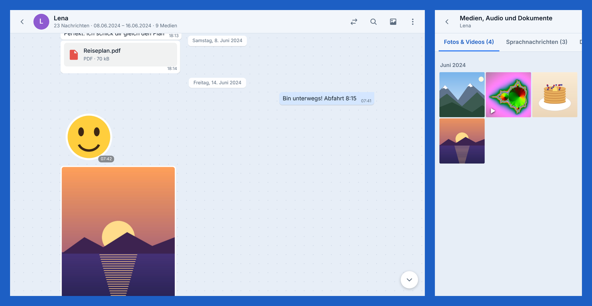

# Chat Archive Viewer – für exportierte WhatsApp-Chats

**Lies exportierte WhatsApp-Chats am Computer wie auf dem Handy, mit Fotos, Videos und Sprachnachrichten. Alles bleibt auf deinem Gerät.**

[🇬🇧 English](README.md) · 🇩🇪 Deutsch

**[⬇️ Chat-Archive-Viewer.html herunterladen](https://github.com/Motox29/chat-archive-viewer/releases/latest/download/Chat-Archive-Viewer.html)** · **[▶️ Online öffnen](https://motox29.github.io/chat-archive-viewer/)** · von Emre Sahin



Chat Archive Viewer ist eine einzige HTML-Datei. Du öffnest sie im Browser und wählst die ZIP-Datei, die WhatsApp beim *Chat exportieren* erzeugt. Dann erscheint der Verlauf als Sprechblasen, mit Fotos, Videos, abspielbaren Sprachnachrichten und Dokumenten an der richtigen Stelle. Du musst nichts installieren, es ist kein Server beteiligt, und die App funktioniert auch offline.

## Stichworte

WhatsApp-Chat anzeigen · WhatsApp-Export am PC öffnen · WhatsApp-Chat-Archiv · WhatsApp-Sprachnachrichten (.opus) am Computer abspielen · WhatsApp-Verlauf sichern und lesen

## Funktionen

- **Sieht aus wie auf dem Handy:** Sprechblasen, Datumsanzeige für jeden Tag, Uhrzeiten, Formatierung mit *fett*, _kursiv_ und ~durchgestrichen~, klickbare Links und große Einzel-Emojis.
- **Medien im Verlauf:** Fotos (mit Großansicht, in der du mit den Pfeiltasten blätterst), Videos, Sticker und Dokumente.
- **Sprachnachrichten:** Play-Taste, Schieberegler und Geschwindigkeit 1×/1,5×/2×. Mehrere Sprachnachrichten hintereinander laufen automatisch weiter.
- **Perspektive wechseln (⇄):** Du siehst den Chat aus der Sicht der anderen Person.
- **Suche** (Strg+F) mit Sprung zum nächsten oder vorherigen Treffer, **Sprung zu einem Datum** sowie zum Anfang oder Ende des Chats.
- **Mediengalerie:** alle Fotos und Videos nach Monaten sortiert, dazu alle Sprachnachrichten und Dokumente.
- **Liste fehlender Medien:** WhatsApp lässt beim Export oft Medien weg. Die App listet jede Lücke pro Tag auf, mit dem Suchbegriff aus dem Datum (z. B. `20210610`), damit du die Dateien auf dem Handy wiederfindest. Du kannst Tage abhaken und die Liste kopieren.
- **Große Chats:** Medien werden erst geladen, wenn sie ins Bild kommen. Die ZIP wird bei Bedarf gelesen und nicht komplett in den Speicher entpackt.
- **Oberfläche auf Deutsch und Englisch.** Die Sprache richtet sich nach dem Browser und lässt sich jederzeit umschalten.
- **Merkt sich die letzte Datei** in Chrome und Edge. Das erneute Öffnen ist dann ein Klick.

## Schnellstart

**Variante A: herunterladen und lokal benutzen (empfohlen für private Chats)**

1. Lade **[Chat-Archive-Viewer.html](https://github.com/Motox29/chat-archive-viewer/releases/latest/download/Chat-Archive-Viewer.html)** herunter (eine Datei, ca. 70 kB).
2. Öffne die Datei in **Chrome, Edge oder Firefox**.
3. Klicke auf **ZIP-Datei wählen** und wähle deinen Export aus.

**Variante B: online**

Öffne **https://motox29.github.io/chat-archive-viewer/**. Dort gibt es auch den Button **Demo ansehen**. Dein Chat wird trotzdem nur in deinem Browser gelesen und nie hochgeladen.

## So exportierst du einen Chat aus WhatsApp

1. Öffne den Chat in WhatsApp.
2. **Android:** ⋮ → *Mehr* → *Chat exportieren*. **iPhone:** oben auf den Namen tippen → *Chat exportieren*.
3. Wähle **Einschließlich Medien** und bring die ZIP-Datei auf den Computer, z. B. per Cloud, USB oder E-Mail.

Grenzen, die WhatsApp vorgibt: Mit Medien enthält ein Export höchstens die **10.000 neuesten Nachrichten**, ohne Medien bis zu 40.000. Medien, die nicht mehr auf dem Handy liegen, stehen im Export als `<Medien ausgeschlossen>` und erscheinen unter *Medien → Fehlend*.

## Unterstützte Exporte

| | Android | iPhone |
|---|---|---|
| Format | `dd.mm.yy, HH:MM - Name: Text` | `[dd.mm.yy, HH:MM:SS] Name: Text` |
| Anhänge | `IMG-…jpg (Datei angehängt)` | `<Anhang: 00000012-PHOTO-….jpg>` |
| Getestete Sprachen | Deutsch, Englisch | Deutsch, Englisch |

Automatisch erkannt werden die Reihenfolge von Tag und Monat (`dd/mm` oder `mm/dd`), das 12- und 24-Stunden-Format, mehrzeilige Nachrichten, gelöschte und bearbeitete Nachrichten, Systemmeldungen und Gruppenchats mit mehreren Personen. Du kannst eine ZIP, einen entpackten Ordner oder eine einzelne `.txt`-Datei öffnen.

## Datenschutz

Die App schickt deine Daten nirgendwohin. Dateien werden über die File-API des Browsers gelesen, und ZIP-Einträge entpackt der eingebaute `DecompressionStream`. Im Browser (`localStorage`/IndexedDB) gespeichert werden nur: welcher Name „du“ bist, die Sprache, die als gefunden abgehakten Tage und ein Verweis auf die zuletzt geöffnete Datei.

## Browser

Aktuelle Versionen von **Chrome, Edge und Firefox** unterstützen alles. Safari kann das meiste, ältere Versionen spielen aber keine `.opus`-Sprachnachrichten ab. „Letzte Datei merken“ braucht die File System Access API, also Chrome oder Edge, und die Seite muss als lokale Datei oder über https geöffnet sein.

## Aufbau

```
index.html          die komplette App (HTML, CSS, JS – ohne Abhängigkeiten)
demo/               zwei erfundene Demo-Exporte (Android Deutsch, iPhone Englisch)
docs/               Screenshots für die README
tools/make_demo.py  erzeugt die Demo-Exporte neu (braucht Python, Pillow, ffmpeg)
```

### Weitere Sprache hinzufügen

Alle Texte der Oberfläche stehen im Objekt `I18N` oben im Script von `index.html`. Kopiere den Block `en`, übersetze die Werte und ergänze ein `<option>` in beiden `.langSel`-Auswahlfeldern. Für die Datumsformate erweiterst du `LOC()`.

## Mitmachen

Issues und Pull Requests sind willkommen, besonders Beispiel-Exporte aus anderen Handysprachen, die der Parser noch nicht erkennt. **Bitte lade niemals echte Chats hoch.** Anonymisiere den Text vorher und schick nur ein paar Zeilen.

## Lizenz

[MIT](LICENSE) © 2026 Emre Sahin

*Chat Archive Viewer ist ein unabhängiges Projekt und steht in keiner Verbindung zu WhatsApp oder Meta Platforms, Inc. „WhatsApp“ ist eine Marke des jeweiligen Inhabers.*
