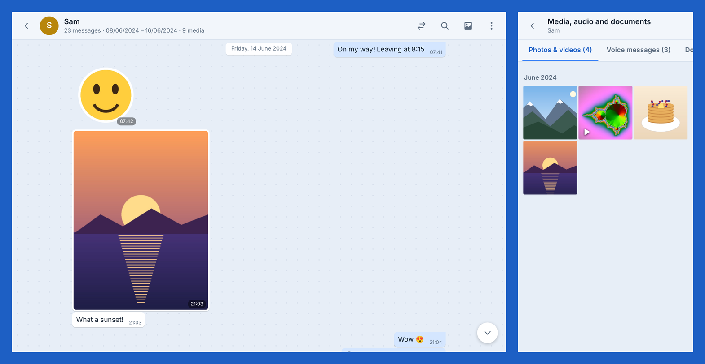

# Chat Archive Viewer – for exported WhatsApp chats

**Read exported WhatsApp chats on your computer the way you read them on your phone, with photos, videos and voice messages. Everything stays on your device.**

🇬🇧 English · [🇩🇪 Deutsch](README.de.md)

**[⬇️ Download Chat-Archive-Viewer.html](https://github.com/Motox29/chat-archive-viewer/releases/latest/download/Chat-Archive-Viewer.html)** · **[▶️ Open online](https://motox29.github.io/chat-archive-viewer/)** · by Emre Sahin



Chat Archive Viewer is a single HTML file. Open it in your browser, choose the ZIP file that WhatsApp's *Export chat* creates, and the conversation appears as chat bubbles, with photos, videos, playable voice messages and documents in place. There is nothing to install and no server involved, and the app works offline.

## Keywords

WhatsApp chat viewer · WhatsApp export viewer · open WhatsApp chat export ZIP on PC · read WhatsApp backup · play WhatsApp voice messages (.opus) on computer

## Features

- **Looks like the phone:** chat bubbles, a date header for each day, timestamps, *bold*, _italic_ and ~strikethrough~ formatting, clickable links and large single emoji.
- **Media inline:** photos (with a full-screen viewer you can page through with the arrow keys), videos, stickers and documents.
- **Voice messages:** a play button, a seek bar and 1×/1.5×/2× speed. Consecutive voice messages play one after the other.
- **Switch perspective (⇄):** view the conversation as the other person.
- **Search** (Ctrl+F) with next/previous match, **jump to date**, and jump to the start or end of the chat.
- **Media gallery:** every photo and video by month, plus all voice messages and documents.
- **Missing media list:** WhatsApp often leaves media out of an export. The app lists every gap by day, with the date-based search term (e.g. `20210610`) so you can find the files on your phone. You can tick off days and copy the list.
- **Large chats:** media load lazily, and the ZIP is read on demand, not unpacked into memory.
- **English and German** interface. The language follows your browser and can be switched at any time.
- **Remembers the last file** in Chrome and Edge, so reopening is one click.

## Quick start

**Option A: download and use it locally (recommended for private chats)**

1. Download **[Chat-Archive-Viewer.html](https://github.com/Motox29/chat-archive-viewer/releases/latest/download/Chat-Archive-Viewer.html)** (one file, about 70 kB).
2. Open it in **Chrome, Edge or Firefox**.
3. Click **Choose ZIP file** and select your export.

**Option B: online**

Open **https://motox29.github.io/chat-archive-viewer/**. The page includes a **Try the demo** button. Your chat is still read only in your browser and is never uploaded.

## How to export a chat from WhatsApp

1. Open the chat in WhatsApp.
2. **Android:** ⋮ → *More* → *Export chat*. **iPhone:** tap the contact's name at the top → *Export chat*.
3. Choose **Include media** and copy the ZIP file to your computer, for example via cloud storage, USB or e-mail.

Limits set by WhatsApp: with media, an export contains at most the **10,000 most recent messages**. Without media it contains up to 40,000. Media that are no longer stored on the phone are replaced by `<Media omitted>` and appear under *Media → Missing*.

## Supported exports

| | Android | iPhone |
|---|---|---|
| Format | `dd.mm.yy, HH:MM - Name: text` | `[dd.mm.yy, HH:MM:SS] Name: text` |
| Attachments | `IMG-…jpg (file attached)` | `<attached: 00000012-PHOTO-….jpg>` |
| Languages tested | German, English | German, English |

Day/month order (`dd/mm` vs `mm/dd`), 12- and 24-hour clocks, multi-line messages, deleted and edited messages, system messages and group chats with several senders are detected automatically. You can open a ZIP, an unzipped folder or a single `.txt` file.

## Privacy

The app makes no network requests for your data. Files are read with the browser's File API, and ZIP entries are inflated with the built-in `DecompressionStream`. The only things stored in your browser (`localStorage`/IndexedDB) are which name is "you", the language, the days you ticked off as found, and a handle to the last opened file.

## Browser support

Current **Chrome, Edge and Firefox** support everything. Safari works for most features, but older versions cannot play `.opus` voice messages. "Remember last file" needs the File System Access API (Chrome or Edge, with the page opened as a local file or over https).

## Project structure

```
index.html          the complete app (HTML, CSS, JS – no dependencies)
demo/               two fictional demo exports (German Android, English iPhone)
docs/               screenshots for this README
tools/make_demo.py  regenerates the demo exports (needs Python, Pillow, ffmpeg)
```

### Adding a language

All interface text is in the `I18N` object near the top of the script in `index.html`. Copy the `en` block, translate the values, and add an `<option>` to both `.langSel` dropdowns. For the date formats, extend `LOC()`.

## Contributing

Issues and pull requests are welcome, especially export samples from other phone languages that the parser does not recognise yet. **Please never upload real chats.** Anonymise the text first and include only a few lines.

## License

[MIT](LICENSE) © 2026 Emre Sahin

*Chat Archive Viewer is an independent project and is not affiliated with, endorsed by or connected to WhatsApp or Meta Platforms, Inc. "WhatsApp" is a trademark of its respective owner.*
